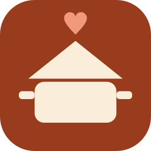

<p align="center">
  
</p>

<h1 align="center">Recetitas en familia</h1>

<p align="center">
  El recetario de casa, para el móvil Android y para Windows.<br>
  Hecho para pasar a limpio las recetas del cuaderno antes de que se estropeen.
</p>

---

## Qué hace

- **Recetas por tipo**: entrantes, primeros, segundos, postres, salsas, masas y panes, y otros. También hay favoritas.
- **Buscar por nombre**, sin importar mayúsculas ni acentos.
- **Colecciones**: listas propias con las recetas que quieras ("Mis recetas", "Navidad"…), desde el botón *Colecciones* de abajo.
- **Versiones de una receta**: varias formas de hacer el mismo plato (empanada de atún de la abuela, con huevo…) se agrupan en una sola tarjeta y al entrar eliges cuál cocinar. Se crean con *Crear otra versión* dentro de la receta.
- **Recetas vinculadas**: un paso puede usar otra receta de la app (la mayonesa casera de la ensaladilla) y un botón te lleva a ella.
- **Foto del plato con el nombre encima**, hecha con la cámara o elegida de la galería.
- **Raciones**: eliges para cuántas personas y las cantidades se recalculan solas (200 g → 300 g). Los huevos salen enteros, y "sal al gusto" se queda igual.
- **Pasos con fuego y tiempo**: vitro (1-12), gas (bajo, medio, alto) u horno (temperatura y modo), por ejemplo "Vitro 6 · 3 min".
- **Foto y nota en cada paso**, para aclarar cosas como "que quede color miel".
- **Utensilios con foto**: se guardan en una lista común, así la sartén grande se fotografía una vez y luego solo se elige. Desde el lápiz o desde el botón *Utensilios* de la pantalla principal se pueden renombrar, cambiar de foto o borrar.
- **Foto del cuaderno original**, para conservar la receta escrita a mano.
- **De quién es la receta** (abuela, mamá, la tía…).
- **Compartir con alguien**: el botón *Compartir → Compartir con alguien* envía un archivo `.receta` por WhatsApp. Quien lo recibe lo toca, la app pregunta "¿Guardar…?" y se guarda sola, con fotos incluidas.
- **PDF**: una receta suelta para enviar o imprimir, o el libro entero ordenado por tipo, con portada e índice.
- **Copia de seguridad diaria** automática (guarda las 7 últimas) y opción de *Exportar todas las recetas* a un archivo.
- **Pensada para usarla con facilidad**: letra grande desde el principio (4 tamaños), botones grandes, tema claro, oscuro o automático, y la pantalla no se apaga mientras ves una receta (se puede quitar en Ajustes).
- **Dictado por voz** en ingredientes, pasos y notas (en el móvil).
- **Actualizaciones**: *Ajustes → Buscar actualizaciones* abre la página de [versiones](https://github.com/peter1323/Recetitas-en-familia/releases) en GitHub. La versión instalada aparece en *Ajustes → Acerca de*.

## Instalar

### Android

Compila el APK y pásalo al móvil:

```bash
./gradlew :androidApp:assembleRelease
```

El archivo queda en `androidApp/build/outputs/apk/release/`. Está firmado con la clave de depuración, así que se instala directamente (hay que permitir "instalar apps de origen desconocido"). Para publicarla en Google Play haría falta crear una clave de firma propia.

### Windows

Crea el instalador `.msi`:

```bash
./gradlew :composeApp:packageMsi
```

Queda en `composeApp/build/compose/binaries/main/msi/`. Al instalarlo, los archivos `.receta` se abren con la app con doble clic.

Para probarla sin instalar:

```bash
./gradlew :composeApp:run
```

## Dónde se guardan los datos

| | Carpeta |
|---|---|
| Android | Dentro de la app (se borra si se desinstala: usa *Exportar todas las recetas* antes). |
| Windows | `C:\Users\<usuario>\RecetitasEnFamilia` |

Dentro hay `recetas.json`, `utensilios.json`, `ajustes.json`, la carpeta `fotos` y la carpeta `copias` con las copias diarias. Un archivo `.receta` es un `.zip` con `paquete.json` y sus fotos.

## Cómo está hecha

- Kotlin y Compose Multiplatform: el mismo código para Android y Windows.
- Sin servidor ni cuentas: todo queda en el dispositivo y se comparte con archivos.
- El PDF lo genera la propia app, sin librerías externas.

```
composeApp/src/commonMain   código común (pantallas, datos, PDF)
composeApp/src/androidMain  cámara, compartir, dictado, pantalla encendida
composeApp/src/desktopMain  ventana de Windows
androidApp                  arranque de la app en Android
```

Pruebas:

```bash
./gradlew :composeApp:desktopTest
```

Para sacar una versión nueva se cambian `recetitas.version` y `recetitas.versionCode` en `gradle.properties`. Android y Windows las leen de ahí.

## Autor

Recetitas en familia es una app creada por [peter1323](https://github.com/peter1323). La autoría aparece en *Ajustes → Acerca de*, en las propiedades del `.exe` y del instalador de Windows, en el manifiesto de Android, en los metadatos de cada PDF (y en la portada del libro) y dentro de cada archivo `.receta`.

© 2026 peter1323.
